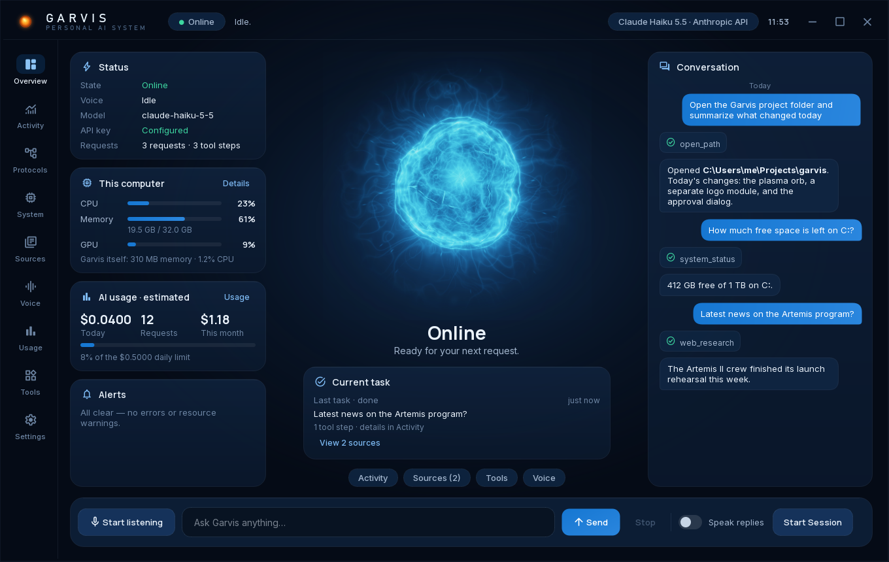
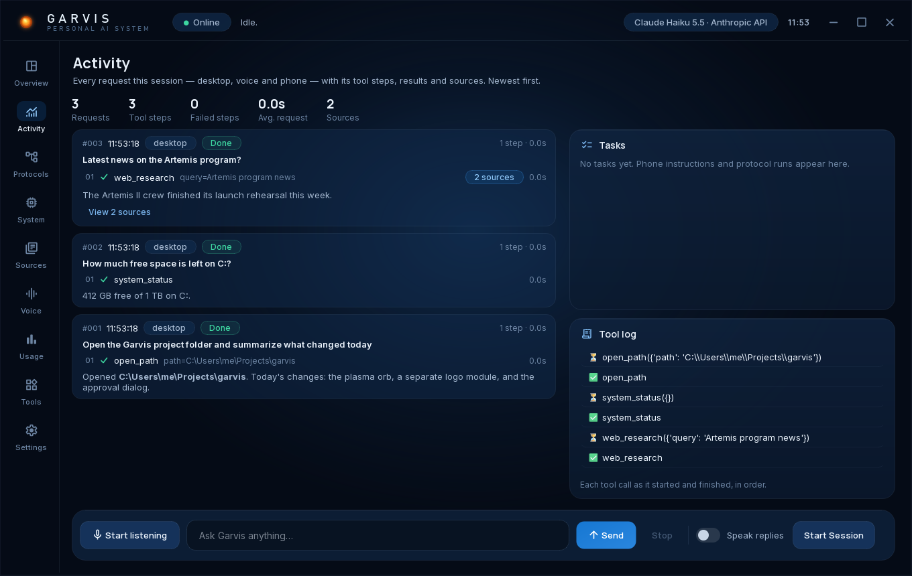
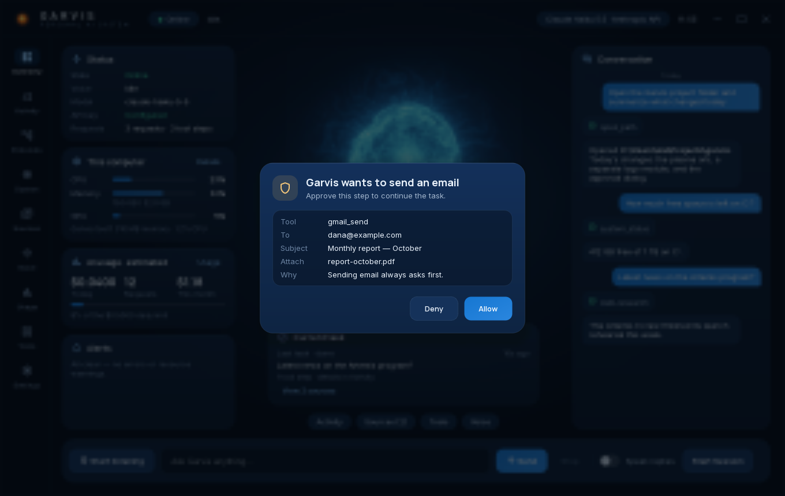
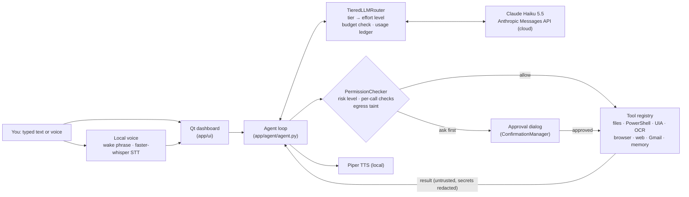

# Garvis Desktop

A voice-and-text AI assistant for Windows that acts on your PC through
permission-checked tools, with the approval rules enforced in code.



Garvis turns a request like *"open the project folder and summarize what
changed today"* into a sequence of tool calls: launching apps, reading files,
running PowerShell, browsing in a controlled browser, operating windows
through UI Automation, reading the screen with OCR, or using Gmail. A cloud
language model plans each step, while Garvis's own code decides which steps
may run on their own and which must be approved by you first. Every
request is metered against local budgets, and speech recognition and speech
synthesis run on your machine.

**Status:** active development · Windows 11 · Python 3.14 · 2,289 automated
tests passing (offline, no API key needed).

## Features

- **Agent loop with real tools.** About 50 tools: apps, files, PowerShell,
  windows, mouse and keyboard, UI Automation, screen OCR, web search and
  research, a controlled browser, Gmail, long-term memory, and a separate
  "Garvis workspace" virtual desktop for background work.
- **Approval rules in code, not in the prompt.** Risky actions (sending
  email, committing clicks, non-read-only PowerShell, writing executables,
  network lookups that could leak data) open a confirmation dialog. The model
  cannot bypass, see or answer that dialog.
- **Spending controls.** A local ledger records the tokens and estimated cost
  of every model request. Per-task, daily and monthly limits stop requests
  before they are sent.
- **Local voice.** Wake phrase, speech-to-text (faster-whisper) and
  text-to-speech (Piper) run locally, with barge-in and echo suppression.
- **Command-center UI.** A Qt dashboard with live activity, sources, tool
  catalogue, usage and system telemetry. Saved multi-step *protocols*
  replay a routine through the same permission checks.

| Activity log | Approval dialog |
|---|---|
|  |  |

*Screenshots are offscreen renders of the real UI with invented sample
content (`scripts/render_ui_review.py --demo --dialog`). Without OpenGL, the
orb is drawn from its pre-rendered frame (`app/ui/orb_still.png`).*

## How it works



1. **Tool-calling loop** (`app/agent/agent.py`). Each turn sends the
   conversation and the tool schemas to the model. If the model asks for tool
   calls, each one is validated, permission-checked, executed, and its result
   appended to the conversation. The loop then repeats until the model
   answers in plain text. A per-turn step limit
   (`GARVIS_AGENT_MAX_TOOL_ITERATIONS`, default 15) and a repeat guard stop
   loops: identical calls are capped, and a call that already failed is not
   retried.
2. **Router and model registry** (`app/llm/router.py`,
   `app/llm/registry.py`, `config/models.json`). Local rules classify each
   request as small, medium or large, without a network call. The tier only
   sets the effort level. Every tier uses the same model, **Claude Haiku
   5.5** through the official Anthropic API. Garvis refuses to start if the
   registry names any other model, and there is no fallback provider.
   Adapters for Gemini, Groq, OpenRouter and OmniRoute exist in `app/llm/`
   but are not used for requests.
3. **Permission and confirmation layer** (`app/security/`). Every tool has a
   risk level. `PermissionChecker` requires confirmation for high-risk tools
   and lets each tool escalate individual calls. Examples: a PowerShell
   command that isn't provably read-only, a committing click, or a URL the
   model composed after reading your data (`egress.py`). A failing check
   fails closed. Approval comes only from you, through the desktop dialog
   (or a paired phone, if the optional phone interface is enabled). The model
   never sees a pending request's id and has no tool that can answer it.
4. **Cost ledger and budgets** (`app/llm/usage.py`). Every request writes one
   SQLite row with the time, task, model, token counts and estimated cost.
   Prompts, replies and keys are never stored. `BudgetGuard` checks the
   per-task, daily and monthly limits *before* each request. These limits
   apply to Garvis's own estimates and are not a billing cap.
5. **Tools** (`app/tools/`, `app/desktop/`, `app/browser/`). They cover
   Windows UI Automation (`comtypes`), Tesseract OCR, PowerShell with a
   command classifier, Playwright (installed Chrome, or Chromium), DuckDuckGo
   search, and a web fetcher pinned to checked public addresses. There are
   also file tools with sensitive-path rules, the Gmail API (OAuth),
   SQLite-backed memory, and `pyvda` for the background virtual desktop.

**Cloud and local.** Language-model inference always runs in the cloud,
through the Anthropic API, using your own API key. Speech recognition
(faster-whisper) and speech synthesis (Piper) run locally on the CPU by
default. Web search, web pages and Gmail naturally use the network.

## Tech stack

Python 3.14 · PySide6 (Qt 6) · Anthropic Python SDK · pydantic ·
httpx/aiohttp · Playwright · faster-whisper · Piper · comtypes (UI
Automation) · pyvda · SQLite · pytest · ruff.

## Requirements

- **Windows 10 or 11, 64-bit** (developed and tested on Windows 11).
- **Python 3.14, 64-bit** from [python.org](https://www.python.org/downloads/);
  "Install for current user" is enough. No admin rights are needed.
- **Internet access** for the first setup: about 1 GB of Python packages plus
  a 60 MB voice.
- **An Anthropic API key** from the
  [Anthropic Console](https://console.anthropic.com/). API use is billed by
  Anthropic to **your** account.
- **Optional:**
  - microphone and speakers for voice;
  - Google Chrome for the browser tools (otherwise run
    `.venv\Scripts\python.exe -m playwright install chromium` once);
  - [Tesseract OCR](https://github.com/tesseract-ocr/tesseract) for reading
    text off the screen.

## Install and run

1. Clone or unzip the project into a **short path** such as `C:\garvis`. The
   folder path must stay within about 80 characters unless Windows long paths
   are enabled; `run.bat` checks this.
2. Double-click **`run.bat`**, or run it from a terminal in the project
   folder.

On first run, `run.bat` does the following:

1. checks for Python 3.14 (64-bit);
2. creates a private `.venv`;
3. installs the pinned dependencies (`requirements.txt` + `constraints.txt`);
4. creates `.env` from `.env.example` and offers to save your API key;
5. downloads the default Piper voice into `data\voices`;
6. starts Garvis.

Later runs skip the steps that are already done. `run.bat --setup-only` sets
everything up without starting Garvis. Nothing outside the project folder is
changed.

Type a message and press Enter, or click **Start listening** to talk. The API
key, model, budgets, voice, Gmail and every other setting are covered in
[docs/CONFIGURATION.md](docs/CONFIGURATION.md).

## Tests

```bat
.venv\Scripts\python.exe -m pip install -r requirements-dev.txt -c constraints.txt
set QT_QPA_PLATFORM=offscreen
.venv\Scripts\python.exe -m pytest -p no:cacheprovider -q --timeout=60 ^
  --deselect tests/test_single_instance_hotkey.py::test_real_registerhotkey_detects_conflicts_and_cleans_up
.venv\Scripts\ruff.exe check .
.venv\Scripts\ruff.exe format --check .
```

Latest local run: **2,289 passed, 14 skipped, 1 deselected**.

The suite is offline. It never uses your API key or your `data/` folder,
and it fakes the model, the browser and the audio devices.

- **Skipped tests:** live desktop tests run only with
  `GARVIS_LIVE_DESKTOP_TESTS=1`. A few others need files that aren't in this
  repository.
- **Deselected test:** it briefly registers the unused global hotkey
  `Ctrl+Alt+Shift+F23`.
- **CI:** `.github/workflows/ci.yml` runs the same lint, format and test
  commands on `windows-latest`.
- **Smoke tests:** `scripts\smoke_test_*.py` are manual checks that use real
  hardware or a real API key. Read each one before running it.

## Security

Approval rules are enforced by code, and web content and tool output are
treated as untrusted. Secrets are redacted from tool output, and model
replies are logged by length and hash, not text. Web fetches can't reach
private or local addresses, including through DNS rebinding. Garvis opens no
listening port by default. [SECURITY.md](SECURITY.md) has the full threat
model, the network-command rules and how to report a vulnerability.
`scripts\secret_scan.py` checks a working copy for committed secrets before
you publish a fork.

## Project structure

```text
app/
  agent/      tool-calling loop, context, memory, system prompt
  llm/        Anthropic provider, tiered router, model registry, usage ledger
  security/   permission checker, confirmations, command and egress rules
  tools/      tool implementations and registry
  desktop/    UI Automation, OCR, input, windows, virtual desktop
  browser/    Playwright browser manager and web research
  voice/      wake phrase, STT, TTS, VAD, echo guard, sessions
  tasks/      background tasks and saved protocols
  ui/         Qt dashboard, approval dialog, orb, telemetry
  mobile/     optional phone interface (off by default, not supported here)
config/       model registry (models.json)
scripts/      setup checks, smoke tests, screenshot renderer, secret scan
tests/        offline pytest suite
docs/         configuration guide and screenshots
```

## Known limitations

- **Windows only, one model.** Garvis uses Claude Haiku 5.5 only, with no
  fallback provider. It needs a network connection and an Anthropic API key.
- **Phone interface.** The optional phone interface (`app/mobile/`,
  reminders, image generation) is off unless `GARVIS_MOBILE_ENABLED=true`.
  It is not supported in this release, and its companion apps are not
  published.
- **Background workspace.** The "Garvis workspace" virtual desktop relies on
  an undocumented Windows API (`pyvda`). If a Windows update breaks it,
  background research reports an error instead.
- **Elevated windows and real input.** Garvis can't control elevated (admin)
  windows. Real mouse and keyboard input works only on the desktop you're
  looking at.
- **Languages.** Wake phrases, OCR and reminder wording are tuned for English
  and Hebrew.

## License

No license has been chosen yet, so all rights are reserved. The bundled fonts in `app/ui/fonts/`
keep their own licenses (Inter and Manrope: SIL Open Font License 1.1;
Material Symbols: Apache 2.0). Python packages, Piper voices and Whisper
models are downloaded under their own licenses.
